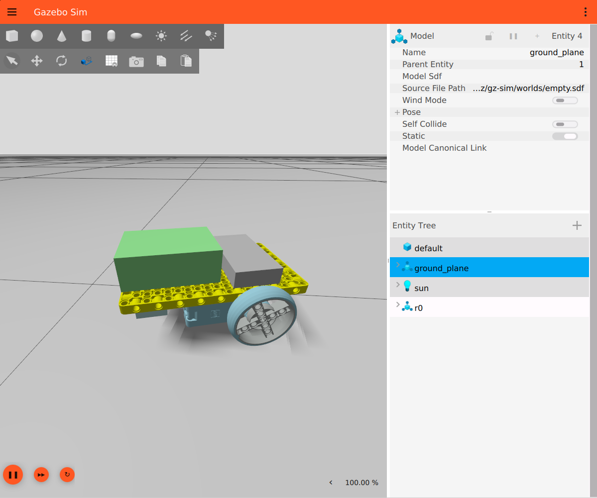
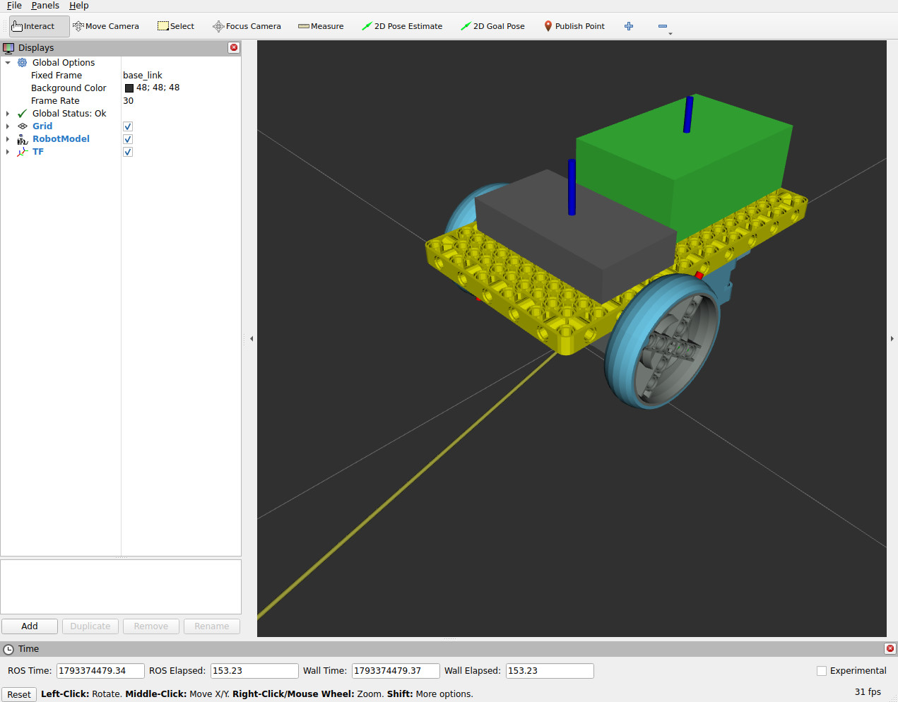

# tuw_build_hat

ROS 2 packages to drive a LEGO differential-drive vehicle with a Raspberry Pi [Build HAT](https://www.raspberrypi.com/products/build-hat/), on the real robot and in Gazebo, using [ros2_control](https://control.ros.org).

## packages

* [tuw_build_hat_driver](tuw_build_hat_driver/README.md) pure C++ driver for the Build HAT over a serial connection (firmware upload, motors), no ROS dependency at runtime
* [tuw_build_hat_hardware_interface](tuw_build_hat_hardware_interface/README.md) ros2_control hardware interface `tuw_build_hat_hardware_interface/BuildHatHardwareInterface` based on the driver
* [tuw_build_hat_description](tuw_build_hat_description/README.md) robot description (`models/lego_diffdrive/main.xacro`) and meshes of the LEGO vehicle
* [tuw_build_hat_bringup](tuw_build_hat_bringup/README.md) launch files and controller configuration to start the vehicle in simulation (`setup:=gz`) or on hardware (`setup:=hw`)

## build

```bash
cd <your_ws>
colcon build --symlink-install --packages-up-to tuw_build_hat_bringup tuw_build_hat_hardware_interface
source install/setup.bash
```

## tmux demo

### simulation

`tmux/demo_gz.yml` starts the whole simulation in one tmux session: empty world, clock bridge, vehicle (spawned as soon as the world is ready) and teleop.

```bash
tmuxinator start -p tmux/demo_gz.yml
```

| Gazebo | rviz2 |
|---|---|
|  |  |

### real robot

`tmux/demo_hw.yml` has to be started on the Raspberry Pi itself and brings up the vehicle on the real hardware in a `robot` pane, together with a `teleop_input` pane to drive it.

```bash
tmuxinator start -p tmux/demo_hw.yml
```

Three launch arguments differ from their defaults:

* `setup:=hw` loads the `BuildHatHardwareInterface` instead of the Gazebo plugin
* `serial_port:=/dev/ttyAMA0` the Build HAT talks over the Pi's built-in UART, the launch default is `/dev/ttyUSB0`
* `rviz_launch:=false` the Pi usually runs headless, start rviz2 on your desktop instead

`teleop_twist_keyboard` only reads keys from the terminal that owns it, so keep the focus in the `teleop_input` pane while driving. To use a gamepad instead, comment the keyboard line in `tmux/demo_hw.yml` and enable the prepared line above it:

```bash
ros2 run tuw_gamepad gamepad_node --ros-args -p use_stamped_velocity:=true -p scale_linear:=0.5 -p scale_angular:=3.14 -p debug:=true
```

Both demo files use the tmux session name `build_hat`, so stop a running session with `tmuxinator stop build_hat` before starting the other one.

The individual commands are described in [tuw_build_hat_bringup](tuw_build_hat_bringup/README.md).
