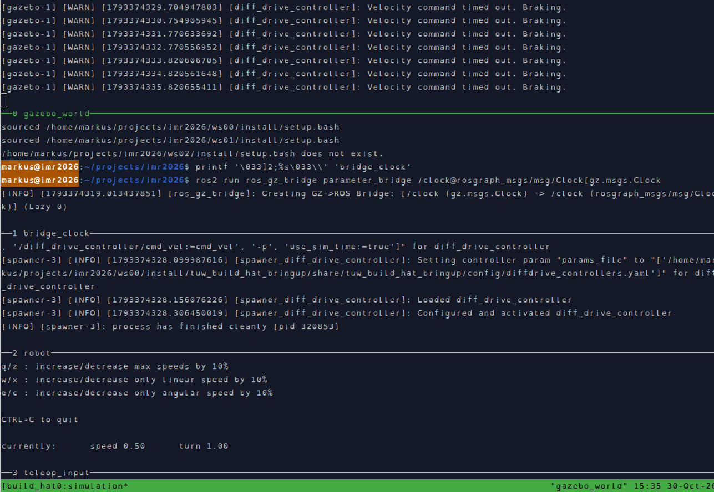
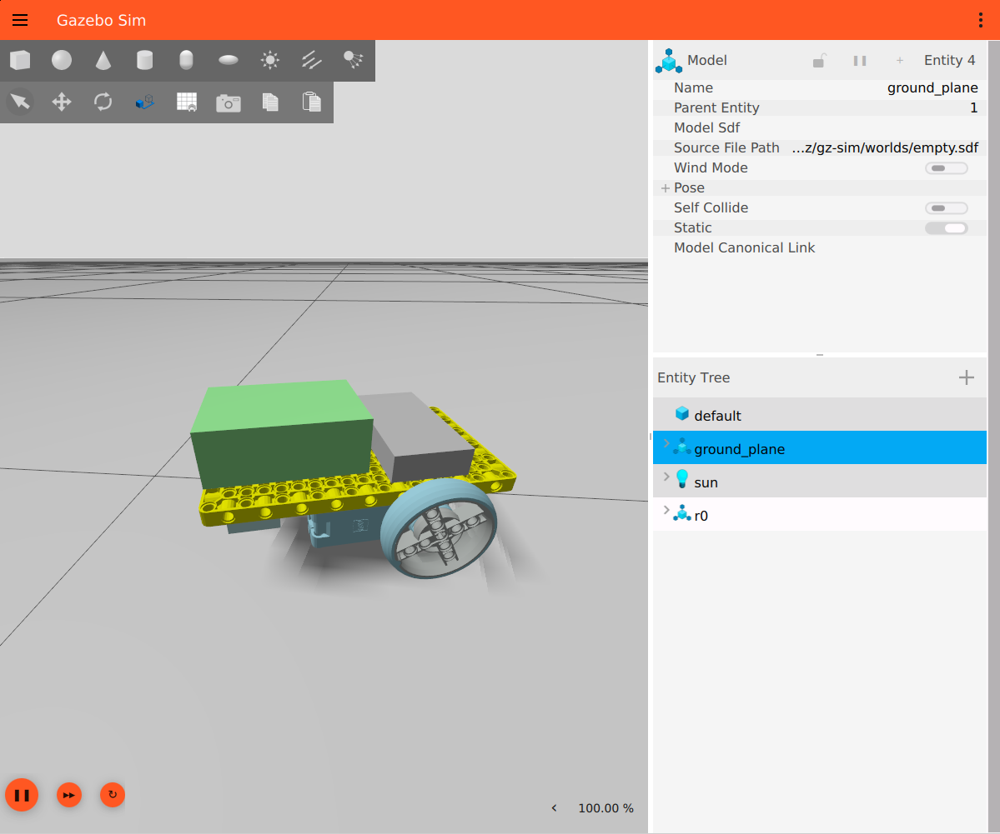
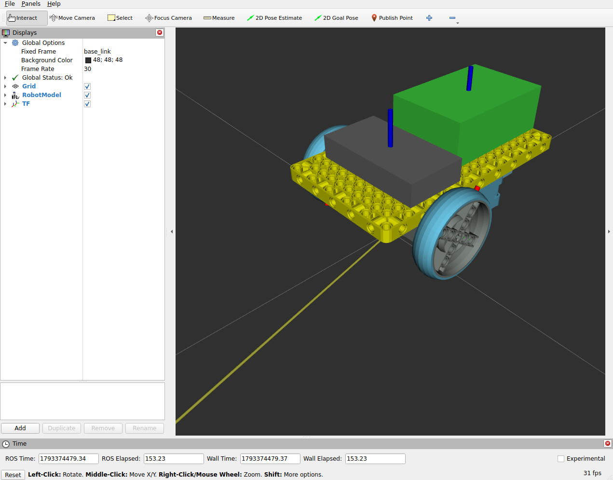

# tuw_build_hat

ROS 2 packages to drive a LEGO differential-drive vehicle with a Raspberry Pi [Build HAT](https://www.raspberrypi.com/products/build-hat/), on the real robot and in Gazebo, using [ros2_control](https://control.ros.org).

## packages

* [tuw_build_hat_driver](tuw_build_hat_driver/README.md) pure C++ driver for the Build HAT over a serial connection (firmware upload, motors), no ROS dependency at runtime
* [tuw_build_hat_hardware_interface](tuw_build_hat_hardware_interface/README.md) ros2_control hardware interface `tuw_build_hat_hardware_interface/BuildHatHardwareInterface` based on the driver
* [tuw_build_hat_description](tuw_build_hat_description/README.md) robot description (`models/lego_diffdrive/main.xacro`) and meshes of the LEGO vehicle
* [tuw_build_hat_bringup](tuw_build_hat_bringup/README.md) launch files and controller configuration to start the vehicle in simulation (`setup:=gz`) or on hardware (`setup:=hw`)

## build

```bash
cd <your_ws>
colcon build --symlink-install --packages-up-to tuw_build_hat_bringup tuw_build_hat_hardware_interface
source install/setup.bash
```

## tmux demo

`tmux/demo_gz.yml` starts the whole simulation in one tmux session: empty world, clock bridge, vehicle (spawned as soon as the world is ready) and teleop.

```bash
tmuxinator start -p tmux/demo_gz.yml
tmuxinator start -p tmux/demo_gz.yml world=<name>   # other world, the <world name> inside <name>.sdf must match
```

| tmux session | Gazebo | rviz2 |
|---|---|---|
|  |  |  |

The individual commands are described in [tuw_build_hat_bringup](tuw_build_hat_bringup/README.md).
